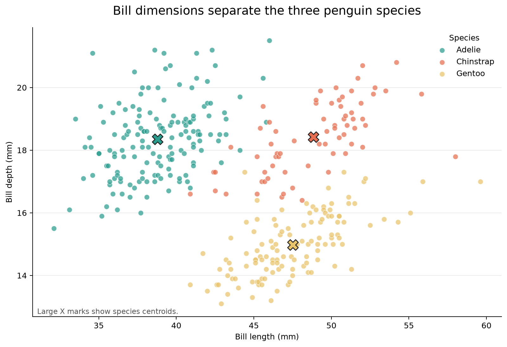
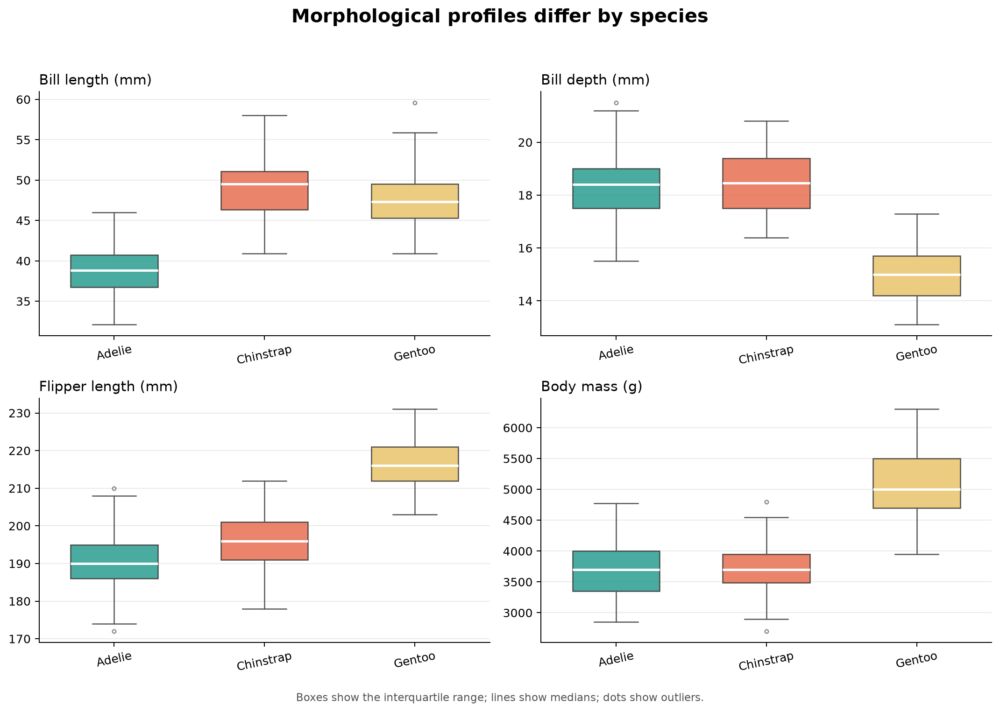
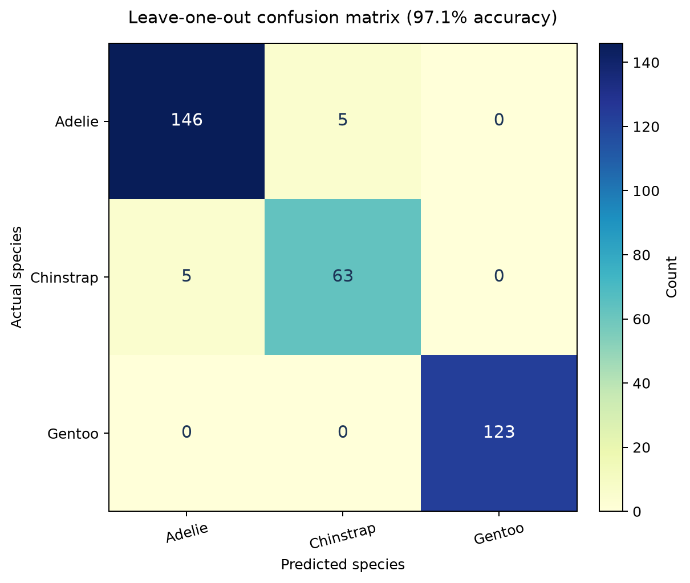

# Identifying Penguin Species from Morphological Measurements

A reproducible data science project using the public Palmer Penguins dataset.

> **At a glance:** Four morphological measurements distinguish three penguin species, and a nearest-centroid classifier reaches 97.1% leave-one-out accuracy. The main limitation is that the result has not been validated on an independent population.

**Project status:** Completed  
**Code licence:** MIT  
**Data licence:** CC0 1.0

## Research question

How do bill, flipper, and body-mass measurements differ among Adelie, Chinstrap, and Gentoo penguins, and how accurately can these four measurements classify a penguin's species?

## Dataset source and usage permissions

- **Dataset:** Palmer Penguins
- **Source:** [allisonhorst/palmerpenguins](https://github.com/allisonhorst/palmerpenguins)
- **Local file:** `data/penguins.csv`
- **Licence:** [CC0 1.0 Universal](https://creativecommons.org/publicdomain/zero/1.0/) public-domain dedication
- **Retrieved:** 21 October 2026

The analysis uses 342 complete records: 151 Adelie, 68 Chinstrap, and 123 Gentoo penguins. Rows missing any of the four model features were excluded. The dataset contains ecological measurements only; it contains no personal, confidential, or restricted information.

## Visualizations

### 1. Bill dimensions by species



Chinstrap penguins have relatively long but shallow bills, Adelie penguins have shorter and deeper bills, and Gentoo penguins occupy a distinct region with a comparatively shallow bill depth. The highlighted X marks show each species centroid.

### 2. Morphological profiles



Gentoo penguins have noticeably longer flippers and greater body mass. Adelie and Chinstrap overlap more strongly on bill depth, which helps explain the small number of classification errors between these two species.

### 3. Classification performance



The four-feature nearest-centroid classifier achieved **97.1% leave-one-out accuracy**. All 123 Gentoo penguins were classified correctly. The only errors were five Adelie penguins predicted as Chinstrap and five Chinstrap penguins predicted as Adelie.

## Methods and tools

- **Python 3.11** for the reproducible analysis script
- **pandas** for loading, filtering, grouping, and summary tables
- **NumPy** for feature scaling and nearest-centroid calculations
- **Matplotlib** for publication-quality visualizations
- **Validation:** leave-one-out nearest-centroid classification
- **Preprocessing:** complete-case filtering and fold-level z-score standardisation
- **Evaluation:** overall accuracy and a three-class confusion matrix

No train/test split is used because leave-one-out validation makes better use of this relatively small dataset while keeping every evaluated observation out of its own training fold.

## Key findings

1. Gentoo penguins are clearly separated from the other two species by longer flippers and greater body mass.
2. Bill measurements provide useful separation, but Adelie and Chinstrap overlap in bill depth.
3. A simple nearest-centroid model using bill length, bill depth, flipper length, and body mass achieved **97.1% leave-one-out accuracy**.
4. The confusion matrix shows that all errors involved Adelie and Chinstrap, the two most similar species in this feature space.

## Limitation

The evaluation uses a single observational dataset from the Palmer Archipelago and does not test the model on penguins from another location or time period. The high in-dataset accuracy therefore describes separability within these samples, not guaranteed performance on new populations. A future version should validate the classifier on independent data and report uncertainty.

## Reproducing the analysis

### 1. Clone the repository

```bash
git clone https://github.com/YOUR-GITHUB-USERNAME/data-science-project.git
cd data-science-project
```

### 2. Create and activate a virtual environment

Windows PowerShell:

```powershell
python -m venv .venv
.\.venv\Scripts\Activate.ps1
```

macOS or Linux:

```bash
python3 -m venv .venv
source .venv/bin/activate
```

### 3. Install dependencies

```bash
python -m pip install --upgrade pip
python -m pip install -r requirements.txt
```

### 4. Run the analysis

```bash
python analysis.py
```

The script reads `data/penguins.csv`, prints the sample size and accuracy, and regenerates:

- `images/bill_scatter.png`
- `images/trait_profiles.png`
- `images/confusion_matrix.png`
- `outputs/species_summary.csv`
- `outputs/confusion_matrix.csv`
- `outputs/metrics.json`

A successful run ends with output similar to:

```text
Clean sample size: 342
Leave-one-out accuracy: 97.1%
Outputs written to: .../outputs and .../images
```

## Project structure

```text
data-science-project/
├── analysis.py
├── data/
│   ├── README.md
│   └── penguins.csv
├── images/
│   ├── bill_scatter.png
│   ├── confusion_matrix.png
│   └── trait_profiles.png
├── outputs/
│   ├── confusion_matrix.csv
│   ├── metrics.json
│   └── species_summary.csv
├── .gitignore
├── LICENSE
├── README.md
└── requirements.txt
```

## Data safety and privacy

This repository contains no passwords, API keys, credentials, personal records, or restricted datasets. The included data are public-domain ecological measurements. `.env` files, key files, virtual environments, and common secret-related filenames are excluded by `.gitignore`.

## Licence

The analysis code is released under the MIT License. The Palmer Penguins data are released separately under CC0 1.0.

